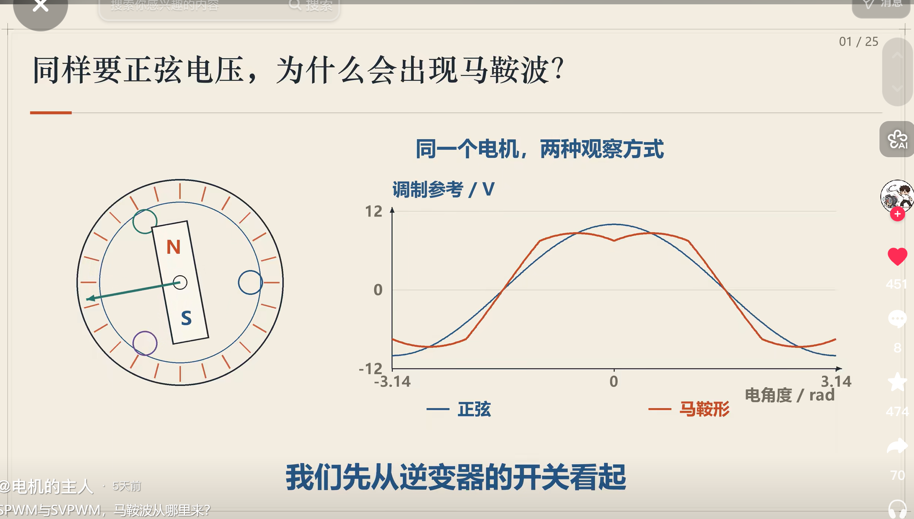
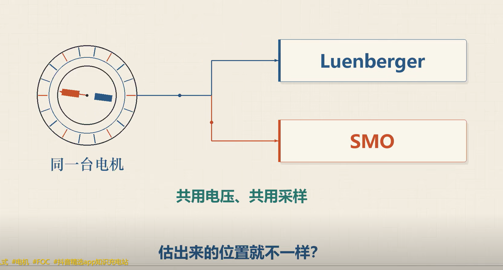

# # Clark 变换

# 电机电磁正向设计八步法（视频原文总结）

核心思路：输入**功率、电压、转速 3 个指标**，正向推演得到一台电机方案

1. **定转矩**：用公式 T=9550·P/n 计算目标转矩
2. **估体积**：同系列电机，转矩和有效体积成正比，参考成熟方案缩放估算
3. **定细长比**：先根据安装边界确定定子外径，再通过细长比算出铁芯叠高
4. **定裂比、气隙**：裂比一般取 0.5～0.73，同步确定气隙大小
5. **反电势定匝数**：主磁通确定后，反电势与匝数成正比，确定绕组匝数
6. **电流、槽满率定导线**：由电流、电流密度算导线截面积，校核槽满率
7. **选槽极配合**：权衡转矩脉动、噪声、绕组工艺；表贴式侧重低脉动，内置式侧重转矩能力
8. **仿真校核收敛**：仿真外特性、齿槽转矩、效率、损耗、温升，迭代优化方案

